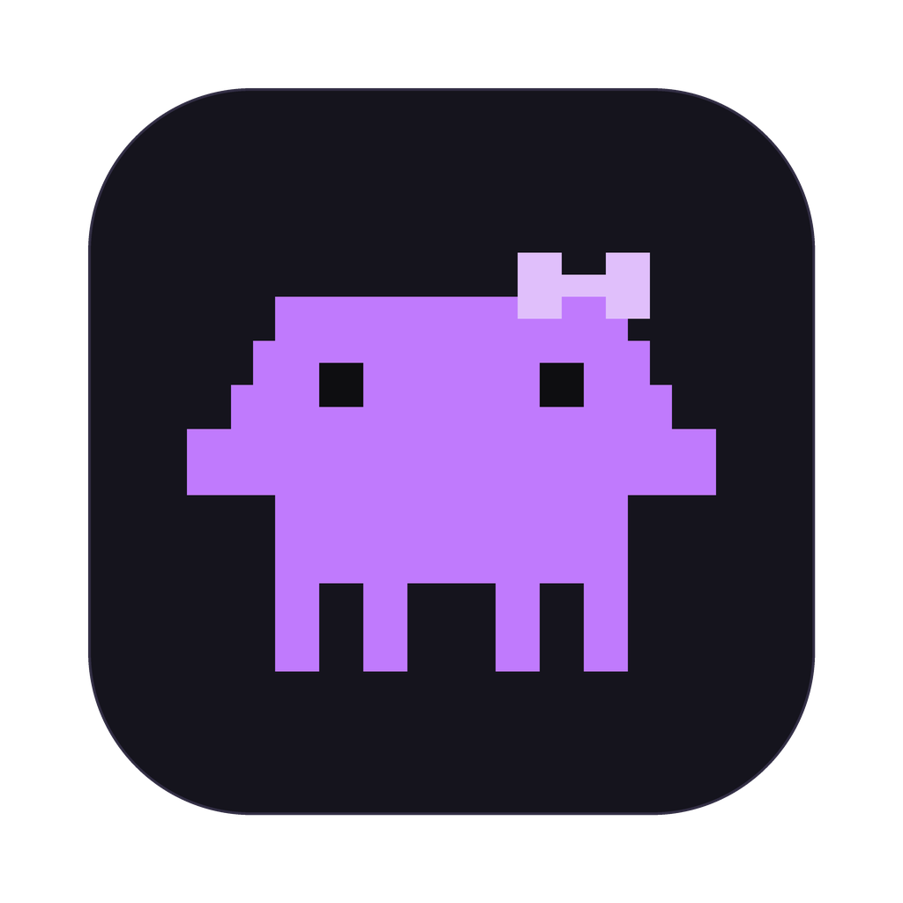

<p align="center">
  
</p>

<h1 align="center">Claudine</h1>

<p align="center">
  A simple / fast / secure desktop editor for Claude Code.<br>
  Run Claude Code in parallel, on all your accounts, and review the work at the end.
</p>

<p align="center">
  <a href="https://github.com/MRVIT-Engineering/claudine/actions/workflows/ci.yml"></a>
  
  
  <a href="LICENSE"></a>
</p>

---

Claudine is a small, native code editor built around your own [Claude Code](https://docs.anthropic.com/en/docs/claude-code) install. Pair with Claude in a chat tab where every edit and command waits for your approval, or hand off several tasks at once and review each one like a pull request. The rules that keep you safe live in the Rust backend, where the UI can't reach them.

> **Status:** version 1.0.0. There are no installers yet: signed macOS builds are waiting on an Apple Developer account, so for now you [build it from source](#build-from-source) on macOS, Linux or Windows.

## Features

### Agentic mode: run many, review once

- Hand Claude a task and start the next one. Each run is its own Claude Code session, in auto mode, on a new branch in its own git worktree, so your checkout is never touched.
- Runs work in parallel, on the same account or on different ones.
- Watch a run's conversation and plan, or steer it with messages while it works.
- Review the result like a pull request: Claude's explanation of every changed file, check results and line comments. Approve to commit, push and open the PR with `gh`, or request changes for another revision.
- Risky actions always ask, even in auto mode. Pushing and opening a PR each need a native confirmation.

### Every Claude account in one editor

- Add as many Claude Code accounts as you like, for example work, personal and a client's, each with its own login.
- Switch accounts from the chat input. The chat starts on the account you used last.
- A run stays on the account it started on. A usage limit pauses it; nothing moves it to another account.
- Sign-in is Claude Code's own (`claude auth`). Claudine never reads, stores or sends a token.

### Editor mode: pair with Claude, approve every step

- Claude runs in an editor tab next to your files. Every write, edit and command shows its content or diff and waits for **Allow** or **Deny**.
- Switch modes (ask, accept edits, plan) with Shift+Tab, and pick the model and effort from the chat input.
- Paste images into a message with ⌘V.
- Stop Claude mid-turn with the stop button or Escape.

### A real editor

- CodeMirror 6 with VS Code-style shortcuts, multiple cursors, find and replace, folding, and syntax highlighting for 140+ languages, each loaded only when a file needs it.
- Draggable tabs, and splits to the left, right, top or bottom.
- A file tree that shows changed files in yellow and new ones in green, go to file, and search across the project.
- A Git panel with changes, side-by-side or inline diffs, and inline blame.
- Markdown preview in the same tab.
- Light and dark themes, accent colors, fonts and panel widths, saved per user.

### Keyboard shortcuts

| Shortcut | Action |
|---|---|
| ⌘O | Open a folder |
| ⌘P or ⌘⇧O | Go to file |
| ⌘⇧P | Command palette |
| ⌘⇧F | Search in all files |
| ⌘⇧E | Show the file tree |
| ⌘S | Save |
| ⌘F | Find in the file |
| ⌃G | Go to line |
| ⇧⌘V | Toggle Markdown preview |
| ⌘+ / ⌘- / ⌘0 | Font size |

On Linux and Windows, use Ctrl in place of ⌘.

## Security

Claudine is built on the assumption that the UI can be compromised, so it never makes security decisions there.

- **The webview is untrusted.** Path checks, approvals and trust decisions are made in Rust. The UI can only ask.
- **Files stay inside the project.** Every file access goes through a path guard built on [`cap-std`](https://github.com/bytecodealliance/cap-std), which also closes symlink races.
- **Approvals can't be rewritten.** Rust keeps each permission request from Claude. The UI answers with an id and yes or no, and Rust sends Claude the input it kept.
- **Folders are trusted explicitly.** Before Claude first runs in a folder, Claudine asks natively, because a project's `.claude/` and `.mcp.json` can run commands.
- **No network from the app.** Only the `claude` process talks to the internet. The one exception is `git push` and `gh pr create` when you approve an Agentic run, after a native confirmation. No telemetry and no update checks.
- **No extensions, ever.** No plugins, no extension marketplace, no theme downloads, no remote code.
- **Your own Claude Code.** Claudine never bundles, downloads or installs it.

Still to come: a tripwire for sensitive files such as SSH keys, an audit log of every decision, and a Claude Code hook that checks each tool call in Rust. See [the development plan](docs/DEVELOPMENT_PLAN.md).

[SECURITY.md](SECURITY.md) has the full model, including known limits and accepted risks. To report a vulnerability, use GitHub's private reporting, as described there. Please don't open a public issue.

## Build from source

### Requirements

- **Claude Code**, installed from Anthropic's [official channel](https://docs.anthropic.com/en/docs/claude-code) and signed in once in a terminal. Claudine uses it; it doesn't include it.
- **Rust**, through [rustup](https://rustup.rs). `rust-toolchain.toml` selects the stable channel.
- **Node.js** 22.12 or newer.
- **pnpm.** Any recent version works: it switches to the version pinned in `package.json`.
- **Tauri's system libraries** for your OS: see the [Tauri prerequisites](https://v2.tauri.app/start/prerequisites/). On Windows that's the Microsoft C++ Build Tools and WebView2, which Windows 10 and 11 already include.
- **On Windows, the native Claude Code install** (`claude.exe`). Claudine doesn't run the npm package's `claude.cmd`: a `.cmd` file runs through `cmd.exe`, which would read `&`, `|` and `%` in Claudine's arguments as commands.
- **git**, and optionally the GitHub CLI (`gh`), signed in, for opening pull requests from Agentic mode.

### Run it

```sh
git clone https://github.com/MRVIT-Engineering/claudine.git
cd claudine
pnpm install
pnpm dev      # run the app in development mode
pnpm build    # build an optimized binary at target/release/my-editor (my-editor.exe on Windows)
```

## Development

```sh
pnpm check           # version check, typecheck and cargo check
pnpm lint            # Biome, cargo fmt --check, clippy
pnpm test            # Rust tests
cargo deny check     # licenses, advisories and sources (cargo install cargo-deny --locked)
pnpm site            # run the website locally
```

CI runs all of these on every pull request, on macOS, Linux and Windows.

Before changing code, read [CLAUDE.md](CLAUDE.md): it has the rules every change follows, such as where security checks live, how new Tauri commands are allowed, and how dependencies are added. [DEPENDENCIES.md](DEPENDENCIES.md) explains why each dependency is here.

### Layout

| Path | What it is |
|---|---|
| `apps/desktop/src` | The UI: SolidJS and TypeScript, treated as untrusted |
| `apps/desktop/src-tauri` | The Rust backend: project files, git, settings, accounts, Claude sessions and Agentic runs |
| `crates/core` | Security logic: the path guard, with the tripwire and audit log still to come |
| `crates/protocol` | Message types shared between the hook and the app |
| `crates/hook` | The Claude Code hook binary, still a stub |
| `apps/website` | The project website at [claudineeditor.com](https://claudineeditor.com): a static Next.js export, separate from the app, deployed to Cloudflare on every push to `main` |
| `docs/DEVELOPMENT_PLAN.md` | Milestones and open decisions |
| `docs/agentic-mode.md` | How Agentic mode works |
| `docs/rust-learning` | The maintainer's Rust learning notes |

The packages and the binary still use the placeholder name `my-editor`.

## Versions and releases

Claudine follows [Semantic Versioning](https://semver.org). The version lives in one place: `version` under `[workspace.package]` in the root `Cargo.toml`. Tauri and Settings → About read it from there. `apps/desktop/package.json` carries the same number, and `pnpm version:check` fails if they differ. It runs in `pnpm check` and in CI.

To release:

1. In a pull request, set the new version in `Cargo.toml` and `apps/desktop/package.json`, run `cargo check` to update `Cargo.lock`, and move the entries under "Unreleased" in [CHANGELOG.md](CHANGELOG.md) to a new version heading.
2. After it merges, tag `main`: `git tag v1.2.0 && git push origin v1.2.0`. On a tag, the version check also requires the tag to match.

## License

[MIT](LICENSE). Claude and Claude Code are products of Anthropic. Claudine is an independent project and isn't affiliated with or endorsed by Anthropic.
